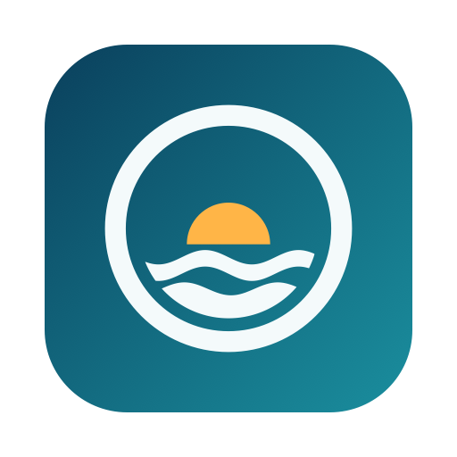
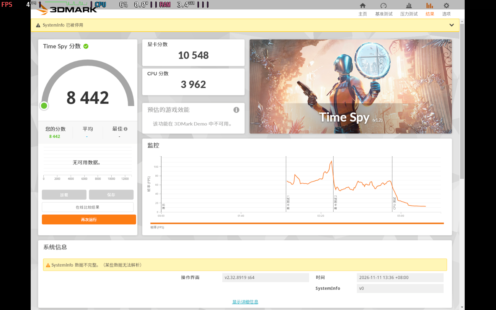

<p align="center">
  
</p>

<h1 align="center">Brinewell</h1>

<p align="center"><strong>English</strong> | <a href="README.zh-CN.md">简体中文</a></p>

Brinewell is a high-performance SteamOS virtual machine for Apple Silicon Macs. Its
Neptune graphics path sends Direct3D 11/12 calls from games in SteamOS straight to Apple's
D3DMetal on the host. In 3DMark Time Spy, its graphics performance matches CrossOver
running natively on macOS (see [Performance](#performance)). The macOS app hosts the VM
in-process with [libkrun](https://github.com/libkrun/libkrun), shows SteamOS in a
dedicated window, and forwards physical gamepads, keyboard, mouse and trackpad input.

Brinewell was inspired by [steamac](https://github.com/fxgl/steamac).

> [!NOTE]
> Brinewell is an AI vibe-coding project: the vast majority of its code was written by AI.

> [!WARNING]
> Brinewell is experimental software. The VM writes directly to its disk image with no
> snapshots or automatic rollback. Brinewell is not affiliated with Valve or Apple.
> Neither a SteamOS image nor Apple's `D3DMetal.framework` is distributed with it.

## Contents

- [Features](#features)
- [Performance](#performance)
- [Requirements](#requirements)
- [Installation](#installation)
- [Usage](#usage)
- [Architecture](#architecture)
- [Building from source](#building-from-source)
- [Testing](#testing)
- [Automation: control FIFO](#automation-control-fifo)
- [Known limitations](#known-limitations)
- [Contributing](#contributing)
- [License](#license)
- [Acknowledgements](#acknowledgements)

## Features

- **Guided SteamOS setup.** Download the ARM64 SteamOS recovery image from Valve or use
  a local one, and Brinewell creates and installs the system disk.
- **Near-native Direct3D performance.** Neptune forwards D3D11/D3D12 calls from Proton to
  the host, where **D3DMetal** (user-supplied, x86-64) or **Mullion** (bundled, arm64,
  based on DXMT) executes them. Guest submissions and fences use shared-memory rings
  and doorbells instead of round trips. A Venus-only (Vulkan) mode is also available.
- **Easy Anti-Cheat support.** An EAC-patched FEX is used by default, so some EAC games,
  such as Elden Ring Nightreign, start with anti-cheat enabled.
- **Live graphics backends.** Switch between Venus (Vulkan), Neptune / D3DMetal and
  Neptune / Mullion at any time; the selection applies to the next game launch and
  keeps the Steam-selected compatibility tool unchanged.
- **Native display path.** Guest scanouts are imported as Metal textures with no CPU pixel
  copies. Supports custom resolutions/refresh rates up to 8K, native full screen
  (including the notch area), and macOS Game Mode.
- **Native input.** Physical gamepads (GameController), keyboard, and captured relative
  mouse/trackpad input with scrolling.
- **Game performance overlay.** Host-drawn FPS, frame time and Mac CPU/GPU/power/memory
  telemetry in five detail levels.
- **Integration.** Bidirectional plain-text clipboard, shared Mac folder, SOCKS5/HTTP(S)
  proxy or physical-interface networking, and one-click UU accelerator install.

## Performance

3DMark Time Spy v1.2 (standard preset, graphics tests at 2560×1440) on the same Mac
(Apple M5 Max), both with D3DMetal 4.0b3:

| Configuration | Graphics score | GT1 FPS | GT2 FPS |
|---|---:|---:|---:|
| CrossOver 26.3, native macOS (1 run) | 10446 | 70.87 | 57.89 |
| **Brinewell, Neptune / D3DMetal** (median of 4 runs) | **10480** | **71.82** | **57.62** |

The four Brinewell runs scored 10548, 10481, 10463 and 10478, a spread of 0.8%, in a VM
with 8 vCPUs.



> [!NOTE]
> This compares graphics only. CPU scores are not comparable: CrossOver uses every host
> core natively (CPU score 17500), whereas the VM runs x86-64 code through FEX on 8 vCPUs
> (about 4000). The CrossOver figure is a single run, and 3DMark used 18
> threads there versus 8 in the VM.

## Requirements

To run Brinewell:

- A Mac with Apple Silicon running macOS 15 or later.
- Rosetta 2, for the D3DMetal backend (its render worker is x86-64).
- For the D3DMetal backend: an x86-64 `D3DMetal.framework` that you obtain yourself, for
  example from Apple's Game Porting Toolkit. The context integration targets D3DMetal
  4.0b3; other versions fall back to the plain rendering path.
- Free disk space for the system disk (64 GiB to 1 TiB, chosen at setup).

## Installation

1. Download `Brinewell-<version>.dmg`, open it and drag `Brinewell.app` to
   `Applications`. When upgrading, shut down the VM and quit Brinewell first, then choose
   **Replace**. Release notes are in [CHANGELOG.md](CHANGELOG.md).
2. Launch Brinewell. If no usable system disk is found, choose **Fresh Install**, then
   pick **Download from Valve** or a **Local Image** (ARM64 recovery image in `.img`,
   `.raw` or `.img.bz2`), the disk capacity, location, CPU count and memory.
   Alternatively choose an existing Brinewell system disk.
3. For the D3DMetal backend, open **Settings**, select **Neptune / D3DMetal** and click
   **Choose Framework** to point at `D3DMetal.framework`.
4. Click **Start**. The status stays *starting* until the guest reports ready, then
   SteamOS appears in its own window.

> [!NOTE]
> Current builds are ad-hoc signed. Public distribution still requires
> [Developer ID signing and notarization](https://developer.apple.com/documentation/xcode/packaging-mac-software-for-distribution).

## Usage

### Settings

Settings are validated and saved automatically to
`~/Library/Application Support/Brinewell/configuration.json` (readable only by the
current user). A corrupt or invalid file is never overwritten; fix it and reload.
Settings cannot be changed while the VM is running, and most take effect on the next VM
start.

- **System disk, CPUs, memory.** The disk must be an existing, readable and writable raw
  image. Brinewell locks it against concurrent use, but does not validate its format or
  bootability.
- **Network.** Without a proxy, guest traffic and DNS are bound to the first connected
  Wi-Fi/Ethernet service in system order, bypassing host TUN routes. You can instead set
  `socks5://`, `http://` or `https://` proxy URLs with host, port and optional
  credentials (`127.0.0.1` means the Mac). SOCKS5 forwards TCP and UDP (the server must
  support UDP ASSOCIATE); HTTP(S) uses CONNECT and forwards TCP only. Guest DNS goes
  through the proxy over TCP. Failed connections never fall back to a direct connection,
  and ICMP is not tunnelled. Restart the VM after switching Wi-Fi or Ethernet.
- **Shared folder.** Choose a Mac folder, read-only by default. In SteamOS it is mounted
  at `/run/brinewell/shared`.
- **VM display.** Resolution and integer refresh rate are limited by the host screen and
  the 8192-pixel guest DRM limit. High modes use DisplayID extended timings, so 5K/6K/8K
  work. Before the VM starts, the launcher's screen is used; afterwards, the VM window's
  screen. Moving the window to a less capable screen lowers the mode automatically.

### Graphics performance

Performance: **Neptune / D3DMetal > Neptune / Mullion > Venus only**.

| Backend | Host side | Guest architectures | Time Spy graphics |
|---|---|---|---:|
| Neptune / D3DMetal (default) | User-supplied x86-64 `D3DMetal.framework` | x86-64 only | ≈10480 |
| Neptune / Mullion | Bundled arm64 Mullion library | x86-64 and ARM64 | ≈5670 |
| Venus only | Proton's standard Vulkan translation over virtio-gpu Venus | — | not measured |

The Mullion figure comes from a single run at a 2560×1600 presentation size,
with known unimplemented paths. Mullion is still being optimised.

The backend takes effect on the next game launch. Older configurations with *Automatic* or
no backend load as D3DMetal. A missing dependency is reported as an error, and Brinewell
does not silently fall back to Venus.

When Mullion or D3DMetal is active, the bundled `org.brinewell.render-context`
LaunchAgent exchanges XPC endpoints between the VM and the render workers. It carries no
graphics data and never starts the VM at login. If macOS asks, allow Brinewell under
**System Settings → General → Login Items & Extensions** and restart the VM.

### Graphics backends

The **Graphics Backend** picker is live while the VM runs: Venus, Neptune / D3DMetal
and Neptune / Mullion can be selected per game launch without restarting Steam or
the VM. The framework path, aperture and multi-ring options remain boot-only.

- The game keeps whatever compatibility tool Steam selected for it, including
  third-party tools. Neptune binds only its own D3D payload files into the game's
  container namespace and leaves the tool, prefix and game files untouched.
- Venus launches and unsupported tools pass through byte-for-byte.
- Brinewell-owned compatibility tools from older releases are migrated back to
  their original base tools automatically before Steam starts.
- ARM64 tools require Mullion. When switching to D3DMetal, select the x86-64 tool for
  affected games.
- The multi-ring option maps to `NPT_PERF=multi_ring` and is off by default.

### NGX super resolution

Neptune / D3DMetal ships opt-in `nvngx.dll` and `nvapi64.dll` shims that let a
game use D3DMetal's NGX super resolution. They are per-game: add
`BRINEWELL_NGX_SR=1 %command%` to the game's Steam launch options. Nothing is
installed system-wide, so Steam itself never loads nvapi64.

- Only recognized x86-64 Proton launches on the Neptune / D3DMetal backend are
  eligible; other backends and ARM64 tools ignore the option.
- On a qualifying launch the two DLLs are deployed differently. `nvapi64.dll`
  is read-only bound over the selected tool's own NVAPI copy source
  (`files/lib/wine/nvapi/x86_64-windows/nvapi64.dll`), so Proton's normal
  prefix setup installs the payload copy itself; the wrapper never writes,
  deletes or backs up `nvapi64.dll` in the prefix. `nvngx.dll` stays a
  managed single file inside the game prefix's
  `pfx/drive_c/windows/system32`. A foreign `nvngx.dll`/`_nvngx.dll` already
  in the prefix — any other provider — is never overwritten, backed up or
  adopted; the launch just keeps the plain Neptune injection. The same
  applies to a `WINEDLLOVERRIDES` entry covering either name or to an
  explicitly disabled Proton NVAPI install.
- The wrapper only declares the launch a *candidate*: it passes
  `BRINEWELL_NGX_SR_CANDIDATE=1` plus the expected SHA-256 of both DLLs and
  clears any inherited `BRINEWELL_NGX_SR_ACTIVE`. The Windows side of
  Neptune then verifies, inside the game process, that the two files that
  process sees in System32 match those digests; only a process that passes
  sets `BRINEWELL_NGX_SR_ACTIVE` for itself, so a child process cannot
  inherit activation and a stale prefix cannot fool the check.
- Opting out takes full effect at the next Proton prefix setup: with the
  launch option removed the bind is gone, so the tool's stock `nvapi64.dll`
  is copied again on the next setup run, while the wrapper removes only its
  own `nvngx.dll` and marker on the next launch. A file you replaced
  afterwards is left alone.
- Games that still do not expose an upscaler option are outside the
  supported scope: several SDK loaders check the core library's signature
  or trust chain (the shipped `nvngx.dll` carries no embedded Authenticode
  signature), and driver registry or Streamline plugin checks can gate the
  feature independently of where the files came from.

### Anti-cheat (EAC)

Brinewell ships an FEX build with Easy Anti-Cheat patches ([StonkGuy/FEX](https://github.com/StonkGuy/FEX/tree/eac-2610) tag
`eac-2610.5`, from the [fex-eac](https://github.com/StonkGuy/steamac/tree/fex-eac) project) and installs it into Steam's FEX-Emu tool
by default. Steam runs every x86-64 Proton under that tool. With it, some games protected
by EAC start with anti-cheat enabled, for example Elden Ring Nightreign. Support depends on
each game's EAC configuration, so not every EAC title works, and other anti-cheat systems
are not covered.

- The patched build is applied before every Steam start, so it is restored automatically
  after Steam updates the FEX-Emu tool. Valve's build is backed up first.
- In the guest, `/usr/lib/brinewell/steam-fex-eac status` shows which build is installed.
  With Steam closed, `steam-fex-eac restore` puts Valve's build back and turns the patch
  off; `steam-fex-eac enable` turns it on again.
- Some titles also need `FEX_NEEDSSECCOMP=1 %command%` in their launch options.

### Game profiles

Optimisation profiles for Cyberpunk 2077, 3DMark, Elden Ring Nightreign and Sekiro are enabled by
default. The offline sync sets the game's launch options to `brinewell-game-launch`,
keeping existing and later user options. Complex shell launch options must be combined
by hand. You can also set it manually in Steam:

```text
/usr/lib/brinewell/brinewell-game-launch --profile cyberpunk2077 -- %command%
```

### Running 3DMark standalone

With Neptune / D3DMetal selected, switch SteamOS to Desktop Mode. This needs x86-64
Proton 11.0, FEX-Emu and Steam Linux Runtime 4 in the default Steam library.

1. Download the Windows standalone ZIP from
   [UL](https://benchmarks.ul.com/direct-download/) and extract it.
2. Install Chromium if it is missing, either from Discover or with
   `flatpak install --user flathub org.chromium.Chromium`.
3. Open **3DMark Standalone (Neptune)** from the application menu and choose
   `data_x64.msi`, or run
   `/usr/lib/brinewell/3dmark-standalone --install ~/Downloads/3DMark/data_x64.msi`.
4. Install tests from the Benchmarks page with your own UL license. After installing Time
   Spy, open the menu entry once more so the launcher can add the bundled shader compiler.

The program and results live in `~/3dmark-standalone/pfx`, and logs in `install.log` and
`launch.log` next to it. Brinewell does not distribute 3DMark or license keys.

### Game performance overlay

Five levels: Off, FPS, Compact, Detailed and Full. Place the overlay in any corner of the
VM window. You can switch levels while running, and the choice is saved.

- **Compact:** game FPS, average frame time, host CPU/GPU usage, power and unified memory.
- **Detailed:** adds a frame-time graph, temperatures, frequencies, GPU memory and battery.
- **Full:** adds 1% low, frame-time range, per-core state, swap, memory pressure, fans and
  an estimate of total system power.

Frame data comes from successful game Presents, measured per swapchain over the last 10
seconds (up to 4096 intervals; 1% low needs at least 100 samples). It is not the VM
window, Gamescope or GPU execution time. Supported content: Neptune D3D11/D3D12 games and
X11 Vulkan games; native Wayland games are not yet covered. Hardware metrics describe the
whole Mac, and missing values are hidden rather than shown as zero. The overlay does not
depend on SteamOS's own performance overlay.

### Display, full screen and Game Mode

- The windowed VM keeps the guest aspect ratio and scales for Retina. It shrinks to fit the
  desktop and follows guest mode changes.
- The green button or **Control+Command+F** enters native full screen in its own Space.
  On notched displays the image extends around the notch. If the private window API this
  relies on is unavailable, the system safe area is used.
- Brinewell declares macOS Game Mode support. macOS decides whether to enable it, subject
  to your saved preference. If the work-context integration is unavailable (for example
  an unsupported D3DMetal version), Brinewell tells you. You can then turn Game Mode off
  from the Game menu in the menu bar, or with **Command+Esc** on macOS 26+.
- Steam's Game Mode UI renders at Gamescope's actual output size to avoid blurry
  upscaling. Steam's per-game resolution and UI scale settings are left unchanged.

### Input

Physical input is forwarded only while the SteamOS window is key and Brinewell is in the
foreground. Switching away releases all keys and buttons and centres the axes. After
closing the window or requesting shutdown, input stays stopped for that run.

- **Gamepad.** The first connected controller with an extended gamepad profile is used,
  with hot-plug support. Buttons, triggers, sticks, D-pad and menu map to the Xbox layout,
  plus back, Home and stick buttons where the device has them. Rumble, multiple players,
  lights and gyro are not supported.
- **Keyboard.** Physical key codes go to a dedicated virtio-input keyboard. Command and
  Command shortcuts stay with macOS.
- **Mouse and trackpad.** Click the guest image to capture the pointer (the first click
  only captures). Relative motion, five buttons, dragging and two-axis scrolling are
  forwarded. Press **Control+Option** to release. Focus loss, minimising, closing or
  stopping also releases it.

### Clipboard

Plain text up to 64 KiB syncs both ways in Desktop Mode (Plasma Wayland) and Game Mode
(Steam and per-game Xwayland). Copy on the Mac, switch to the VM window and paste. Or copy
in SteamOS, switch back to the Mac and press **⌘V**.

### UU accelerator

With SteamOS running, click **Install UU** in the main window. Brinewell checks the
system, downloads and verifies the plugin from UU's official servers, configures a
dedicated runtime and enables autostart. No Steam game, FEX or SSH/sudo password setup is
needed. Then scan the binding QR code with the UU mobile app and enable acceleration
there. The guest log is `/var/log/brinewell/uu.log`. The plugin is downloaded at install
time and is not bundled.

### Starting, stopping and logs

- **Shut Down** requests a graceful shutdown. **Force Stop** asks for confirmation and
  may corrupt the file system. Quitting Brinewell while the VM runs prompts you to shut
  it down first.
- `Brinewell.app/Contents/MacOS/Brinewell --start-vm` loads the saved configuration and
  starts the VM once, still inside the app process.
- `brinewell-vm` is a standalone entry point to the same runtime, with options such as
  `--disk`, `--cpus`, `--memory-gib`, `--graphics-backend venus|neptune|mullion`,
  `--game-hud-level 0-4` and `--game-hud-position top-left|top-right|bottom-left|bottom-right`.
- Each run creates a `0700` directory `/tmp/brinewell-<UUID>` containing `host.log`,
  `console.log`, `progress.log`, `gvproxy.log` and `control.fifo`. It is kept after exit,
  and the main window shows its path.
- Guest SSH is forwarded to host port `2222`.

## Architecture

```text
macOS host (Apple Silicon)                         SteamOS guest (ARM64)
┌─────────────────────────────────────────┐        ┌──────────────────────────────────┐
│ Brinewell.app (Swift)                   │        │ Brinewell kernel + initramfs     │
│  launcher · VM window · input · HUD     │        │ guest layer (EROFS):             │
│  └─ libkrun VMM (Hypervisor.framework)  │◄──────►│  Mesa (Venus/zink) · agent       │
│      ├─ virtio-gpu ─ virglrenderer      │virtio  │  Neptune payload · MangoApp      │
│      │   ├─ Venus → MoltenVK/KosmicKrisp│        │ Steam → Proton + FEX             │
│      │   └─ Neptune render workers      │        │  └─ Neptune d3d11/d3d12/dxgi DLLs│
│      │       ├─ d3dmetal-native (x86-64)│        │     (from virtio-win-mesa)       │
│      │       │   └─ D3DMetal.framework  │        └──────────────────────────────────┘
│      │       └─ Mullion (arm64)         │
│      └─ gvproxy (network)               │
└─────────────────────────────────────────┘
```

Inside Proton, games use Brinewell's Neptune Wine DLLs, which send D3D11/D3D12 work over
virtio-gpu to per-context host render workers. Desktop and Vulkan content uses Venus.
Display scanouts are imported as Metal textures. Incompatible resources fall back to a
bounded CPU frame pool backed by IOSurface.

## Building from source

### Prerequisites

- macOS 15+ on Apple Silicon and Xcode 26+ (Swift 6, macOS SDK, icon compiler), with
  the Metal Toolchain installed: `xcodebuild -downloadComponent MetalToolchain`.
- Go 1.25+, Homebrew, and a linux/arm64 Podman machine named `brinewell-builder`
  (`podman machine init brinewell-builder && podman machine start brinewell-builder`).
  Override with `BRINEWELL_BUILDER_CONNECTION` / `BRINEWELL_BUILDER_IMAGE`.
- `qemu-img` for `scripts/test-image.sh`.

Pinned third-party sources and releases in [`deps.lock.json`](deps.lock.json) are
downloaded on demand and verified by SHA-256.

### Workspace layout

Brinewell builds several components from sibling checkouts on the `steamos-d3dmetal`
branch:

```text
workspace/
├── Brinewell/         this repository
├── libkrun/           https://github.com/Coulin9/libkrun
├── virglrenderer/     https://github.com/Coulin9/virglrenderer
├── virtio-win-mesa/   https://github.com/Coulin9/mesa
├── d3dmetal-native/   https://github.com/Coulin9/d3dmetal-native
├── Mullion/           https://github.com/Coulin9/mullion
├── neptune-protocol/  https://github.com/Coulin9/neptune-protocol (protocol generator, optional)
└── libepoxy/          cloned automatically at tag 1.5.10
```

```sh
mkdir workspace && cd workspace
git clone https://github.com/Coulin9/libkrun.git -b steamos-d3dmetal
git clone https://github.com/Coulin9/virglrenderer.git -b steamos-d3dmetal
git clone https://github.com/Coulin9/mesa.git virtio-win-mesa -b steamos-d3dmetal
git clone https://github.com/Coulin9/d3dmetal-native.git -b steamos-d3dmetal
git clone https://github.com/Coulin9/mullion.git Mullion -b steamos-d3dmetal
git clone https://github.com/Coulin9/Brinewell.git -b steamos-d3dmetal
```

### Build

```sh
cd Brinewell
./build.sh                          # incremental build (rebuild only changed components)
./build.sh --clean                  # clean full build
./build.sh --reuse kernel,layer     # strictly reuse the named artifacts (fail if stale)
./build.sh --reuse all              # strictly reuse every native/guest artifact
./build.sh --component libkrun      # build a single component (incremental)
./build.sh --list-components
```

Fast development loop (`scripts/dev/`, the VM must be running for all but `test.sh`):

```sh
scripts/dev/test.sh [--all|REPO...]   # host-side suites of changed repositories
scripts/dev/push-neptune.sh           # build Neptune, install it as the guest dev payload
scripts/dev/push-neptune.sh --off     # remove the dev payload (packaged payload again)
scripts/dev/restart.sh [--no-build]   # incremental build, package, headless VM restart
scripts/dev/smoke.sh [--update]       # D3D11 + D3D12 check against the saved reference
scripts/dev/perf.sh [--baseline] [N]  # uncapped D3D11 submission bench vs baseline
```

The dev payload lives in the guest at `~/.local/share/brinewell/neptune-dev`;
`brinewell-graphics-wrap` uses it instead of `/usr/lib/brinewell/neptune` when it
contains `payload.json`, so a Neptune change applies on the next game launch.

| Component | Source | Output |
|---|---|---|
| kernel | Linux 7.2.9 + `runtime/kernel/patches` + `runtime/kernel/config` | `Image` (`7.2.9-brinewell`) |
| libepoxy | upstream libepoxy 1.5.10 | universal `libepoxy.0.dylib` |
| virglrenderer | `../virglrenderer` (Venus + Neptune) | `libvirglrenderer.1.dylib`, universal `virgl_render_server` |
| d3dmetal | `../d3dmetal-native`, x86-64; framework supplied by user | `libd3dmetal-native.dylib` |
| mullion | `../Mullion`, arm64; LLVM 15 + Xcode Metal Toolchain | `libmullion-native.dylib` |
| libkrun | `../libkrun`, init-blob disabled | `libkrun.1.dylib` |
| kosmicrisp | upstream Mesa 26.3 commit `ce576c29ed` | `libvulkan_kosmickrisp.dylib`, `libSPIRV-Tools.dylib` |
| moltenvk | KhronosGroup release 1.4.2 | `libMoltenVK.dylib` |
| gvproxy | v0.8.9 + `runtime/network` egress policy | `gvproxy` |
| macmon | vladkens/macmon v0.11.0 release | host telemetry sampler |
| initramfs | busybox-static, dosfstools, e2fsprogs, btrfs-progs + `runtime/initramfs/init` | `initramfs.cpio.gz` |
| mesa | `../virtio-win-mesa` (Mesa 26.3 base, `-Dneptune=false`) | guest Mesa in layer |
| agent | `runtime/guest/agent` | `brinewell-agent` |
| uu-runtime | pinned FEX + dedicated network tools | UU runtime in layer |
| fex-eac | StonkGuy/FEX `eac-2610.5`, Steam mode, tuned for `apple-m1` | EAC-capable FEX for Steam's FEX-Emu tool |
| mangoapp | MangoHud v0.8.4 + `runtime/patches/mangohud` | guest `mangoapp` |
| guest-integration | `runtime/guest/rootfs` | units/scripts in layer |
| neptune-probe | `runtime/guest/tools`, static aarch64 | `brinewell-api-probe`, `brinewell-gpu-probe` |
| neptune | `../virtio-win-mesa`, pinned llvm-mingw + x86-64 Linux cross toolchain | x86-64 Wine DLLs, `nptunix.so`, `payload.json` |
| layer | guest artifacts above | `brinewell-layer.img` (EROFS, lz4) |
| swift | `Sources/` | `Brinewell`, `brinewell-vm`, `brinewell-diagnostics` |

The app is written in place to `build/Brinewell.app`. The build does not stop a running VM
and does not create backups or a second copy. Intermediates, logs and input/output
digests are in `.build/` and `build/manifest.json`.

### Packaging

- `./scripts/package.sh` rebuilds `build/Brinewell.app` from existing artifacts. It first
  checks every artifact against the recorded SHA-256, and re-checks Swift sources and
  dependencies. It refuses to touch the existing bundle if anything is missing, stale or
  replaced. `./scripts/package.sh --check` runs only the checks.
- `./scripts/package-dmg.sh` creates `build/Brinewell.dmg` from the existing app and
  replaces any previous DMG.
- `./scripts/gpl-source-links.sh <version>` writes `build/Brinewell-<version>-gpl-sources.md`,
  the table of source links for every GPL/LGPL component in the release, for the release
  notes. Run it after the release tag is pushed. It checks every link unless you pass
  `--no-check-links`.
- The app icon source is `Resources/Brinewell.icon`, compiled to `Assets.car`.
  `Resources/Brinewell.icns` is the macOS 15 fallback. Packaging uses the Xcode selected
  by `DEVELOPER_DIR`/`xcode-select`, or `/Applications/Xcode.app` when only the Command
  Line Tools are selected.

> [!IMPORTANT]
> When re-signing `build/Brinewell.app` manually, pass
> `--entitlements BrinewellVM.entitlements`. Otherwise the hypervisor entitlement is
> removed and `VmCreate` fails.

## Testing

```sh
# Swift unit tests (requires full Xcode)
DEVELOPER_DIR=/Applications/Xcode.app/Contents/Developer swift test --disable-sandbox

# Input regression tests only
DEVELOPER_DIR=/Applications/Xcode.app/Contents/Developer swift test --disable-sandbox --filter BrinewellVMTests

# Mouse capture/release check (opens a foreground test window, does not touch the VM)
./scripts/test-mouse-capture.sh

# Guest integration tests
python3 -m unittest discover -s Tests/GuestIntegrationTests

# Fresh 64 GiB test disk from an existing SteamOS disk
./scripts/test-image.sh [SOURCE_DISK]
```

## Automation: control FIFO

While the VM is running, write commands to `control.fifo` in the run directory:

```sh
RUN_DIR="/tmp/brinewell-UUID"
printf 'pad state\n'                    > "$RUN_DIR/control.fifo"
printf 'pad press guide 150\n'          > "$RUN_DIR/control.fifo"
printf 'pad dpad down 150\n'            > "$RUN_DIR/control.fifo"
printf 'pad axis ly -32768 1000\n'      > "$RUN_DIR/control.fifo"
printf 'pad neutral\n'                  > "$RUN_DIR/control.fifo"
printf 'fullscreen on\n'                > "$RUN_DIR/control.fifo"
printf 'frame-dump /tmp/frame.png\n'    > "$RUN_DIR/control.fifo"
printf 'uu status\n'                    > "$RUN_DIR/control.fifo"
printf 'shutdown\n'                     > "$RUN_DIR/control.fifo"
```

| Command | Description |
|---|---|
| `pad state` | Virtual pad readiness (after the guest sends `hello`), scripted action and physical pad state |
| `pad press <button> [ms]`, `pad dpad <dir> [ms]` | Press for 50–2000 ms (default 150), then release |
| `pad axis lx\|ly\|rx\|ry <value> [ms]` | Hold a stick axis at −32768…32767 (negative X = left, negative Y = up) |
| `pad neutral` | End the current scripted action early |
| `fullscreen on\|off` | Set native full screen idempotently; completion is logged as `BRINEWELL display fullscreen on\|off` |
| `frame-dump <absolute.png>` | Save a frame and report `native`, `fallbacks` and `cpu_readback_bytes` counters |
| `uu status`, `uu install` | Query or install UU; progress is logged as `BRINEWELL uu ...` |
| `shutdown` | Request graceful shutdown |

Only one scripted action runs at a time. A physical gamepad taking over cancels it, and new
scripted actions are rejected while it is in control.

## Known limitations

- No disk snapshots or rollback. Do not let other programs write to the image while the
  VM uses it.
- The D3DMetal backend supports only x86-64 Neptune tools. ARM64 tools require Mullion.
- The performance overlay does not cover native Wayland games.
- No rumble, gyro, lights or multi-player gamepad support. No host IME text input.
- HTTP(S) proxies cannot carry game UDP traffic.
- Builds are ad-hoc signed and not notarized.

## Contributing

Development happens on the `steamos-d3dmetal` branch of this repository and the sibling
repositories above. Commits use concise imperative subjects, often with a component prefix
(for example `neptune: refresh managed window state`). Add focused regression tests for
behavioural changes and run the relevant suite. Pull requests should describe the
behaviour change, the affected components, the validation performed and any hardware or
guest setup needed, with screenshots for visible UI changes.

## License

Brinewell is released under the [MIT License](LICENSE). A few parts keep other licenses,
as listed in [NOTICE](NOTICE):

- Guest-integration and initramfs code derived from steamac stays under Apache-2.0.
- The Linux kernel patches and config are under GPL-2.0-only.

Bundled third-party components keep their own licenses; see
[`runtime/licenses/THIRD-PARTY-NOTICES.txt`](runtime/licenses/THIRD-PARTY-NOTICES.txt).

Brinewell is not affiliated with or endorsed by Apple Inc. or Valve Corporation.
Steam, SteamOS and Steam Deck are trademarks of Valve Corporation. Apple, Mac, macOS,
Metal, D3DMetal and Apple Silicon are trademarks of Apple Inc.

## Acknowledgements

Brinewell was inspired by [steamac](https://github.com/fxgl/steamac). It builds on [libkrun](https://github.com/libkrun/libkrun),
[virglrenderer](https://gitlab.freedesktop.org/virgl/virglrenderer),
[Mesa](https://gitlab.freedesktop.org/mesa/mesa), [UTM](https://github.com/utmapp/UTM),
[neptune-protocol](https://github.com/osy/neptune-protocol),
[Mullion](https://github.com/dttdrv/mullion) / [DXMT](https://github.com/3Shain/dxmt),
[MoltenVK](https://github.com/KhronosGroup/MoltenVK),
[gvisor-tap-vsock](https://github.com/containers/gvisor-tap-vsock),
[FEX](https://github.com/FEX-Emu/FEX) and its [EAC patches](https://github.com/StonkGuy/steamac/tree/fex-eac), [MangoHud](https://github.com/flightlessmango/MangoHud),
[macmon](https://github.com/vladkens/macmon) and
[libepoxy](https://github.com/anholt/libepoxy).
