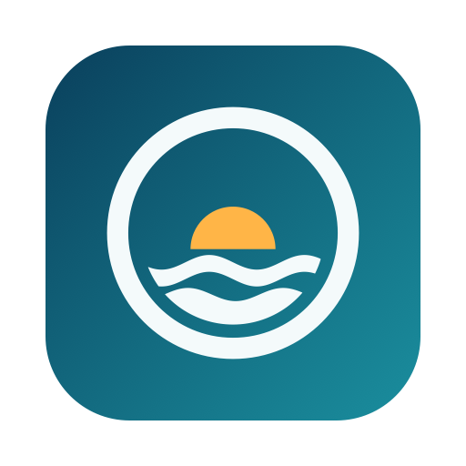
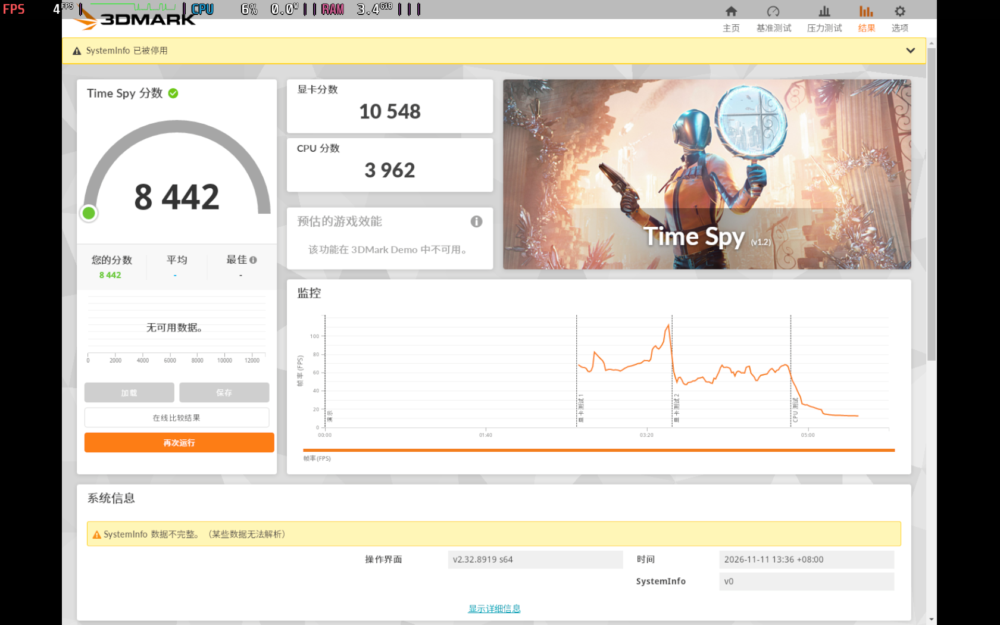

<p align="center">
  
</p>

<h1 align="center">Brinewell</h1>

<p align="center"><a href="README.md">English</a> | <strong>简体中文</strong></p>

Brinewell 是面向 Apple Silicon Mac 的高性能 SteamOS 虚拟机。它的 Neptune 图形通道把
SteamOS 中游戏的 Direct3D 11/12 调用直接交给宿主上 Apple 的 D3DMetal 执行；在 3DMark Time Spy
中，图形性能与在 macOS 上原生运行的 CrossOver 相当（见[性能](#性能)）。macOS 应用在自身进程内用
[libkrun](https://github.com/libkrun/libkrun) 运行虚拟机，SteamOS 显示在独立窗口中，并转发物理
手柄、键盘、鼠标和触控板输入。

Brinewell 受 [steamac](https://github.com/fxgl/steamac) 项目启发。

> [!NOTE]
> Brinewell 是一个 AI VibeCoding 项目，绝大部分代码由 AI 编写。

> [!WARNING]
> Brinewell 是实验性软件。虚拟机直接写入磁盘镜像，没有快照或自动回滚。Brinewell 与
> Valve、Apple 均无关联，不分发 SteamOS 镜像，也不分发 Apple 的 `D3DMetal.framework`。

## 目录

- [功能](#功能)
- [性能](#性能)
- [运行要求](#运行要求)
- [安装](#安装)
- [使用](#使用)
- [架构](#架构)
- [从源码构建](#从源码构建)
- [测试](#测试)
- [自动化：控制 FIFO](#自动化控制-fifo)
- [已知限制](#已知限制)
- [参与开发](#参与开发)
- [许可证](#许可证)
- [致谢](#致谢)

## 功能

- **引导式安装 SteamOS**：从 Valve 下载 ARM64 SteamOS 恢复镜像，或使用本地镜像，由
  Brinewell 创建并安装系统磁盘。
- **接近原生的 Direct3D 性能**：Neptune 把 Proton 中的 D3D11/D3D12 调用转发到宿主，由
  **D3DMetal**（用户提供，x86-64）或 **Mullion**（随包提供，arm64，基于 DXMT）执行。客体提交
  和 fence 通过共享内存环与 doorbell 完成，无需逐次往返；也可只用 Venus（Vulkan）。
- **支持 Easy Anti-Cheat**：默认使用 EAC 反作弊修补版 FEX，部分使用 EAC 的游戏（例如艾尔登法环
  黑夜君临）可以在启用反作弊的情况下运行。
- **实时图形后端**：Venus（Vulkan）、Neptune / D3DMetal、Neptune / Mullion 可随时切换，
  选择在下一次游戏启动时生效，游戏保留 Steam 原选的兼容工具。
- **原生显示路径**：客体 scanout 以 Metal 纹理导入，CPU 不复制像素；支持最高 8K 的自定义
  分辨率和刷新率、原生全屏（含刘海区域）及 macOS Game Mode。
- **原生输入**：物理手柄（GameController）、键盘，以及捕获后的相对鼠标和触控板输入（含滚动）。
- **游戏性能叠层**：由宿主绘制，显示 FPS、帧时间及 Mac 的 CPU/GPU、功耗、内存，共五档。
- **系统集成**：双向纯文本剪贴板、Mac 共享文件夹、SOCKS5/HTTP(S) 代理或物理网卡直连，
  以及一键安装 UU 加速器。

## 性能

3DMark Time Spy v1.2（标准预设，图形测试 2560×1440），同一台 Mac（Apple M5 Max），两者均使用
D3DMetal 4.0b3：

| 配置 | 显卡分数 | GT1 FPS | GT2 FPS |
|---|---:|---:|---:|
| CrossOver 26.3，macOS 原生（1 轮） | 10446 | 70.87 | 57.89 |
| **Brinewell，Neptune / D3DMetal**（4 轮中位数） | **10480** | **71.82** | **57.62** |

Brinewell 四轮显卡分数为 10548、10481、10463、10478，极差 0.8%；虚拟机 8 vCPU。



> [!NOTE]
> 这里只比较图形性能。CPU 分数不可比：CrossOver 原生使用宿主全部核心（CPU 分数 17500），
> 虚拟机则在 8 个 vCPU 上经 FEX 运行 x86-64 代码（约 4000）。CrossOver 数据为单轮测试，
> 且 3DMark 在其中使用 18 线程，虚拟机中为 8 线程。

## 运行要求

运行 Brinewell 需要：

- macOS 26 或更高版本的 Apple Silicon Mac。
- Rosetta 2，用于 D3DMetal 后端（其渲染 worker 为 x86-64）。
- 使用 D3DMetal 后端时，需自行获取 x86-64 `D3DMetal.framework`，例如来自 Apple 的 Game
  Porting Toolkit。工作上下文适配针对 D3DMetal 4.0b3，其他版本使用普通渲染路径。
- 系统磁盘所需的可用空间（安装时可选 64 GiB 至 1 TiB）。

## 安装

1. 下载 `Brinewell-<版本>.dmg`，打开后将 `Brinewell.app` 拖到“应用程序”。升级时先关闭虚拟机
   并退出 Brinewell，再选择“替换”。版本说明见 [CHANGELOG.md](CHANGELOG.md)。
2. 启动 Brinewell。如果找不到可用的系统磁盘，选择“全新安装”，然后选择“从 Valve 下载”或
   “本地镜像”（`.img`、`.raw` 或 `.img.bz2` 格式的 ARM64 恢复镜像），设置磁盘容量、位置、
   CPU 数和内存。也可以选择已有的 Brinewell 系统磁盘。
3. 使用 D3DMetal 后端时，打开“设置”，选择 **Neptune / D3DMetal**，点击“选择框架”指定
   `D3DMetal.framework`。
4. 点击“启动”。状态保持 starting，直到客体报告就绪，随后 SteamOS 显示在独立窗口中。

> [!NOTE]
> 当前构建使用临时签名（ad hoc）。面向用户公开分发前，还需要完成
> [Developer ID 签名与 Apple 公证](https://developer.apple.com/documentation/xcode/packaging-mac-software-for-distribution)。

## 使用

### 设置

设置通过校验后自动保存到 `~/Library/Application Support/Brinewell/configuration.json`
（仅当前用户可读写）。损坏或非法的配置不会被自动覆盖，修复后可重新载入。虚拟机运行期间
不能修改设置，大部分设置在下次启动虚拟机时生效。

- **系统磁盘、CPU、内存**：磁盘必须是已存在、可读写的 raw 镜像。Brinewell 会对镜像加锁
  防止多个实例同时使用，但不校验镜像格式或可引导性。
- **网络**：不使用代理时，客体流量和 DNS 绑定到系统服务顺序中首个已连接的 Wi-Fi/以太网
  接口，从而绕过宿主 TUN 路由。也可以填写 `socks5://`、`http://` 或 `https://` 代理地址，
  须包含主机和端口，可带用户名和密码（`127.0.0.1` 指 Mac 宿主机）。SOCKS5 转发 TCP 和 UDP
  （服务端须支持 UDP ASSOCIATE）；HTTP(S) 通过 CONNECT 只转发 TCP。客体 DNS 通过 TCP 经代理
  查询。连接失败不会自动改为直连，也不提供 ICMP 隧道。切换 Wi-Fi 或网线后需重启虚拟机。
- **共享文件夹**：选择一个 Mac 目录，默认只读，可通过 `/run/brinewell/shared` 访问
  （它是指向 `/run/media/bw-<id8>` 的符号链接）。关闭“只读”并重启虚拟机后，
  支持的文件夹会出现在游戏模式的 **设置 → 存储** 中，可作为 Steam 库下载游戏；
  `/run/media/` 挂载位置使 Steam 和 Proton 容器可以访问它。空文件夹（忽略 `.DS_Store` 等
  macOS 系统文件）或根目录已有 Steam 库（`steamapps/` 或 `libraryfolder.vdf`）的文件夹直接
  使用根目录；其他非空文件夹使用 `SteamLibrary/` 子目录，不影响无关的 Mac 文件。推荐使用
  区分大小写的 APFS；避免宿主和客体同时写入同一个库，弹出外置磁盘前请正常关闭 SteamOS。
  Proton、FEX 和运行时工具默认
  仍保留在内部 SteamOS 磁盘上。
- **虚拟机显示器**：分辨率和整数刷新率受宿主屏幕和客体 DRM 8192 像素上限限制。高分辨率、
  高刷新率模式使用 DisplayID 扩展时序，支持 5K/6K/8K。虚拟机启动前以启动器所在屏幕为准，
  启动后跟踪 VM 窗口所在屏幕；移到能力较低的屏幕时自动降低显示模式。

### 图形后端

性能：**Neptune / D3DMetal > Neptune / Mullion > 仅 Venus**。

| 后端 | 宿主侧 | 客体架构 | Time Spy 显卡分数 |
|---|---|---|---:|
| Neptune / D3DMetal（默认） | 用户提供的 x86-64 `D3DMetal.framework` | 仅 x86-64 | ≈10480 |
| Neptune / Mullion | 随包提供的 arm64 Mullion 库 | x86-64 和 ARM64 | ≈5670 |
| 仅 Venus | Proton 标准 Vulkan 转译，经 virtio-gpu Venus | — | 未测 |

Mullion 数据来自单轮测试，呈现尺寸为 2560×1600，仍有已知未实现的路径；Mullion
仍在持续优化。

后端在下一次游戏启动时生效。旧配置中的“自动”或缺失的后端字段按 D3DMetal 载入。依赖缺失时
会报告错误，不会自动回退到 Venus。

使用 Mullion 或 D3DMetal 时，随包的 `org.brinewell.render-context` LaunchAgent 在虚拟机和
渲染 worker 之间交换 XPC 端点。它不转发图形数据，也不会在登录时启动虚拟机。如果 macOS
提示，请在“系统设置 → 通用 → 登录项与扩展”中允许 Brinewell，然后重启虚拟机。

### 兼容层

游戏始终使用 Steam 为该游戏选择的兼容工具（官方 Proton、GE-Proton 或第三方工具），Brinewell
不再生成或注册自有兼容工具。选择 Neptune 后端时，仅把随包的 D3D payload 以只读方式绑定进该次
游戏的容器命名空间；Venus 与不兼容工具按原样直通。旧版本生成的 Brinewell 自有兼容工具会在
Steam 启动前自动迁回其原始基底工具。

### NGX 超分辨率

Neptune / D3DMetal 默认对符合条件的 x86-64 Proton 游戏启用 NGX 超分辨率，支持 D3D11
和 D3D12，无需配置 Steam 启动选项。要按游戏关闭，可在 Steam 启动选项中设置
`BRINEWELL_NGX_SR=0 %command%`（也可用 `false`、`no`、`off`）。不会做系统级安装，
Steam 自身不会加载 nvapi64。

- 仅 Neptune / D3DMetal 后端下的 x86-64 Proton 启动生效；其他后端和 ARM64 工具会忽略该选项。
- 符合条件的启动对两个 DLL 采用不同部署方式：`nvapi64.dll` 以只读方式绑定覆盖所选工具
  自己的 NVAPI 复制源（`files/lib/wine/nvapi/x86_64-windows/nvapi64.dll`），由 Proton
  正常的前缀 setup 把 payload 副本复制进前缀；wrapper 不在前缀中写、删或备份
  `nvapi64.dll`。`nvngx.dll` 则仍是 wrapper 按游戏管理的单文件，位于该游戏前缀的
  `pfx/drive_c/windows/system32`。前缀中已有第三方 `nvngx.dll`/`_nvngx.dll` 时绝不
  覆盖、不备份、不接管，该次启动只保留普通 Neptune 注入；用户自己的
  `WINEDLLOVERRIDES` 覆盖这两个名字、或显式禁用 Proton NVAPI 安装时同样不启用。
- wrapper 只把该次启动声明为*候选*：它传递 `BRINEWELL_NGX_SR_CANDIDATE=1` 和两个 DLL
  的预期 SHA-256，并清除继承来的 `BRINEWELL_NGX_SR_ACTIVE`。Neptune 的 Windows 侧随后
  在游戏进程内核验该进程从 System32 看到的两个文件的摘要；只有核验通过的进程才为自己
  设置 `BRINEWELL_NGX_SR_ACTIVE`，子进程不能靠继承获得激活，过期前缀也无法骗过核验。
- 取消开启在*下一次* Proton 前缀 setup 后才完全生效：设置关闭选项后绑定消失，工具自带的
  原版 `nvapi64.dll` 在下一次 setup 时被重新复制；wrapper 则在下一次启动时只移除自己
  安装的 `nvngx.dll` 与 marker。被用户替换过的文件保留不动。
- 仍不显示超分选项的游戏不在支持范围内：部分 SDK loader 会校验 core 库的签名或信任链。
  构建时配置签名密钥和证书时 `nvngx.dll` 会内嵌 Authenticode 签名，否则不签名；
  要求 NVIDIA 官方证书链的游戏仍可能拒绝。驱动注册表或 Streamline 插件的检查也可能
  独立于文件来源拦截该功能。

### 反作弊（EAC）

Brinewell 随附带有 Easy Anti-Cheat 补丁的 FEX（[StonkGuy/FEX](https://github.com/StonkGuy/FEX/tree/eac-2610) 的 `eac-2610.5` 标签，来自
[fex-eac](https://github.com/StonkGuy/steamac/tree/fex-eac) 项目），并默认安装到 Steam 的 FEX-Emu 工具中；Steam 的所有 x86-64 Proton 都在该工具下
运行。借助该补丁，部分受 EAC 保护的游戏可以在启用反作弊的情况下启动，例如艾尔登法环 黑夜君临。是否
可用取决于各游戏的 EAC 配置，并非所有 EAC 游戏都能运行；其他反作弊系统不在支持范围内。

- 每次启动 Steam 前都会应用补丁版，因此 Steam 更新 FEX-Emu 工具后会自动恢复；替换前会先备份 Valve 的版本。
- 在客体中运行 `/usr/lib/brinewell/steam-fex-eac status` 查看当前安装的版本。关闭 Steam 后，
  `steam-fex-eac restore` 恢复 Valve 的版本并关闭补丁，`steam-fex-eac enable` 重新开启。
- 个别游戏还需要在启动选项中加入 `FEX_NEEDSSECCOMP=1 %command%`。

### 游戏优化配置

赛博朋克 2077、荒野大镖客：救赎 2、3DMark、黑夜君临和只狼的优化配置默认启用。
荒野大镖客：救赎 2 在 Neptune / Mullion 下没有图形设置时默认使用 DX12，不会覆盖已有设置。
离线同步会把游戏启动选项设为
`brinewell-game-launch`，并保留已有及用户后续修改的选项。复杂的 shell 启动选项需要手动组合。
也可以直接在 Steam 中设置：

```text
/usr/lib/brinewell/brinewell-game-launch --profile cyberpunk2077 -- %command%
```

### 运行独立版 3DMark

选择 Neptune / D3DMetal 后，将 SteamOS 切换到桌面模式。需要默认 Steam 库中已有 x86-64
Proton 11.0、FEX-Emu 和 Steam Linux Runtime 4。

1. 从 [UL 下载页](https://benchmarks.ul.com/direct-download/) 获取 Windows 独立版 ZIP 并解压。
2. 如果没有 Chromium，在 Discover 中安装，或运行
   `flatpak install --user flathub org.chromium.Chromium`。
3. 在应用菜单打开 **3DMark Standalone (Neptune)** 并选择 `data_x64.msi`，或运行
   `/usr/lib/brinewell/3dmark-standalone --install ~/Downloads/3DMark/data_x64.msi`。
4. 在 3DMark 的 Benchmarks 页面用自己的 UL 授权安装测试。安装 Time Spy 后再打开一次菜单项，
   启动器会补齐应用自带的着色器编译器。

程序和成绩位于 `~/3dmark-standalone/pfx`，日志为同目录下的 `install.log` 和 `launch.log`。
Brinewell 不分发 3DMark 安装包或激活码。

### 游戏性能叠层

共五档：关闭、帧率、简洁、详细、完整。叠层可放在 VM 窗口任一角，运行中可切换等级，选择会被保存。

- **简洁**：游戏 FPS、平均帧时间，以及宿主 CPU/GPU 占用、功耗和统一内存。
- **详细**：增加帧时间曲线、温度、频率、GPU 占用的统一内存及电池信息。
- **完整**：增加 1% Low、帧时间范围、逐核状态、交换空间、内存压力、风扇和整机功耗估计。

帧数据来自游戏成功提交的 Present，按 swapchain 统计最近 10 秒（最多 4096 个帧间隔；
1% Low 至少需要 100 个样本）。它不是 VM 窗口或 Gamescope 的刷新率，也不是 GPU 执行耗时。
支持 Neptune D3D11/D3D12 游戏和 X11 Vulkan 游戏，原生 Wayland 游戏暂不支持。硬件指标属于
整台 Mac，缺失值不显示而不是填零。此功能不依赖 SteamOS 自带的性能叠层。

### 显示、全屏与 Game Mode

- 窗口模式保持客体宽高比，按 Retina 缩放；超出桌面时等比缩小，并跟随客体显示模式变化。
- 绿色按钮或 **Control+Command+F** 进入独立桌面的原生全屏。刘海屏上画面延伸到刘海两侧；
  所依赖的非公开窗口接口不可用时，使用系统安全区布局。
- Brinewell 声明支持 macOS Game Mode，是否启用由系统根据你保存的偏好决定。工作上下文适配
  不可用时（例如 D3DMetal 版本不受支持），启动器会提示；此时可通过菜单栏的游戏菜单关闭
  Game Mode，macOS 26 及以后也可按 **Command+Esc** 在游戏叠层设置中关闭。
- Steam 游戏模式界面以 Gamescope 实际输出尺寸渲染，避免放大导致模糊；不修改 Steam 的逐游戏
  分辨率和界面缩放设置。

### 输入

只有 SteamOS 窗口为键窗口且 Brinewell 在前台时才转发物理输入。切换到其他窗口时释放所有
按键和按钮并归零摇杆；关闭窗口或请求关机后，本次运行不再恢复输入。

- **手柄**：使用首个具有 extended gamepad profile 的已连接控制器，支持热插拔。按 Xbox
  布局映射按键、扳机、摇杆、方向键和菜单键，以及设备提供的返回、Home 和摇杆按键。不支持
  震动、多玩家、灯光或陀螺仪。
- **键盘**：物理键码经独立的 virtio-input 键盘转发。Command 及其组合快捷键留给 macOS。
- **鼠标与触控板**：点击客体画面捕获指针（首次点击仅用于捕获），转发相对位移、五个按键、
  拖动和纵横滚动。按 **Control+Option** 释放；失焦、最小化、关闭或停止时也会自动释放。

### 共享剪贴板

桌面模式（Plasma Wayland）和游戏模式（Steam 及各游戏的 Xwayland）均支持与 macOS 双向同步
纯文本，单条最多 64 KiB。在 Mac 上复制后切回 VM 窗口粘贴；或在 SteamOS 中复制后切回 Mac
按 **⌘V** 粘贴。

### UU 加速器

SteamOS 启动后，在主窗口点击“一键安装 UU”。Brinewell 会检查系统，从 UU 官方服务器下载并
校验插件，配置专用运行环境并开启自启动，无需先安装 Steam 游戏、FEX 或配置 SSH/sudo 密码。
之后用手机 UU App 扫描绑定二维码，在手机上开启加速。客体日志位于 `/var/log/brinewell/uu.log`。
插件在安装时下载，不随包分发。

### 启动、停止与日志

- “关机”请求优雅关机；“强制停止”需要确认，可能损坏文件系统。虚拟机运行时退出 Brinewell
  会提示先关机。
- `Brinewell.app/Contents/MacOS/Brinewell --start-vm` 读取已保存配置并自动启动一次虚拟机，
  仍在应用进程内运行。
- `brinewell-vm` 是同一运行时的独立入口，支持 `--disk`、`--cpus`、`--memory-gib`、
  `--graphics-backend venus|neptune|mullion`、`--game-hud-level 0-4`、
  `--game-hud-position top-left|top-right|bottom-left|bottom-right` 等选项。
- 每次运行创建权限为 `0700` 的 `/tmp/brinewell-<UUID>` 目录，包含 `host.log`、`console.log`、
  `progress.log`、`gvproxy.log` 和 `control.fifo`，退出后保留，主窗口会显示其路径。
- 客体 SSH 转发到宿主 `2222` 端口。

## 架构

```text
macOS 宿主（Apple Silicon）                        SteamOS 客体（ARM64）
┌─────────────────────────────────────────┐        ┌──────────────────────────────────┐
│ Brinewell.app (Swift)                   │        │ Brinewell 内核 + initramfs       │
│  启动器 · VM 窗口 · 输入 · 性能叠层     │        │ guest layer (EROFS):             │
│  └─ libkrun VMM (Hypervisor.framework)  │◄──────►│  Mesa (Venus/zink) · agent       │
│      ├─ virtio-gpu ─ virglrenderer      │virtio  │  Neptune 载荷 · MangoApp         │
│      │   ├─ Venus → KosmicKrisp         │        │ Steam → Proton + FEX             │
│      │   └─ Neptune 渲染 worker         │        │  └─ Neptune d3d11/d3d12/dxgi DLL │
│      │       ├─ d3dmetal-native (x86-64)│        │     （来自 runtime/neptune）     │
│      │       │   └─ D3DMetal.framework  │        └──────────────────────────────────┘
│      │       └─ Mullion (arm64)         │
│      └─ gvproxy（网络）                 │
└─────────────────────────────────────────┘
```

在 Proton 中，游戏使用 Brinewell 的 Neptune Wine DLL，经 virtio-gpu 把 D3D11/D3D12 工作发送到
宿主上按上下文创建的渲染 worker。对于桌面和 Vulkan 应用，Venus 在承载 VM 的进程内通过渲染线程向
KosmicKrisp 提交绘制。普通 GPU 图像由驱动分配内存，客体需要访问的缓冲区和交给合成器的图像使用共享内存。显示 scanout 以 Metal 纹理
导入，不兼容的资源回退到以 IOSurface 为后备的有界 CPU 帧池。

## 从源码构建

### 前置条件

- Apple Silicon 上的 macOS 26+，Xcode 26+（含 Swift 6、macOS SDK 和图标编译工具），并安装
  Metal Toolchain：`xcodebuild -downloadComponent MetalToolchain`。
- Go 1.25+、Homebrew，以及名为 `brinewell-builder` 的 linux/arm64 Podman 虚拟机
  （`podman machine init brinewell-builder && podman machine start brinewell-builder`）。
  可通过 `BRINEWELL_BUILDER_CONNECTION` / `BRINEWELL_BUILDER_IMAGE` 覆盖。
- `scripts/test-image.sh` 需要 `qemu-img`。

[`deps.lock.json`](deps.lock.json) 中固定版本的第三方源码和发行文件会按需下载，并以 SHA-256 校验。

宿主 KosmicKrisp 和客体 Venus/Zink 共用 `.build/out/kosmicrisp/src/` 下的官方 Mesa 源码。
Neptune 的客体代码位于 [`runtime/neptune/`](runtime/neptune/)，构建时使用同一版本的 Mesa。

### 工作区布局

Brinewell 从同级目录中 `steamos-d3dmetal` 分支的检出构建多个组件：

```text
workspace/
├── Brinewell/         本仓库
├── libkrun/           https://github.com/Coulin9/libkrun
├── virglrenderer/     https://github.com/Coulin9/virglrenderer
├── d3dmetal-native/   https://github.com/Coulin9/d3dmetal-native
├── Mullion/           https://github.com/Coulin9/mullion
├── neptune-protocol/  https://github.com/Coulin9/neptune-protocol（协议生成器，可选）
└── libepoxy/          构建时自动克隆 1.5.10 标签
```

```sh
mkdir workspace && cd workspace
git clone https://github.com/Coulin9/libkrun.git -b steamos-d3dmetal
git clone https://github.com/Coulin9/virglrenderer.git -b steamos-d3dmetal
git clone https://github.com/Coulin9/d3dmetal-native.git -b steamos-d3dmetal
git clone https://github.com/Coulin9/mullion.git Mullion -b steamos-d3dmetal
git clone https://github.com/Coulin9/Brinewell.git -b steamos-d3dmetal
```

### 构建

```sh
cd Brinewell
./build.sh                          # 全新全量构建
./build.sh --reuse kernel,layer     # 只复用指定制品，其余重编
./build.sh --reuse all              # 复用全部原生/guest 制品
./build.sh --component libkrun      # 单独构建一个组件
./build.sh --list-components
```

| 组件 | 来源 | 产物 |
|---|---|---|
| kernel | Linux 7.2.9 + `runtime/kernel/patches` + `runtime/kernel/config` | `Image`（`7.2.9-brinewell`） |
| libepoxy | 上游 libepoxy 1.5.10 | universal `libepoxy.0.dylib` |
| virglrenderer | `../virglrenderer`（Venus + Neptune） | `libvirglrenderer.1.dylib`、universal `virgl_render_server` |
| d3dmetal | `../d3dmetal-native`，x86-64；框架由用户提供 | `libd3dmetal-native.dylib` |
| mullion | `../Mullion`，arm64；LLVM 15 + Xcode Metal Toolchain | `libmullion-native.dylib` |
| libkrun | `../libkrun`，关闭 init-blob | `libkrun.1.dylib` |
| kosmicrisp | `deps.lock.json` 固定的 Mesa 官方原版发布包 | `libvulkan_kosmickrisp.dylib`、`libSPIRV-Tools.dylib` |
| moltenvk | KhronosGroup 官方 release 1.4.2 | `libMoltenVK.dylib` |
| gvproxy | v0.8.9 + `runtime/network` 出站策略 | `gvproxy` |
| macmon | vladkens/macmon v0.11.0 发行包 | 宿主硬件指标采样器 |
| initramfs | busybox-static、dosfstools、e2fsprogs、btrfs-progs + `runtime/initramfs/init` | `initramfs.cpio.gz` |
| mesa | 与 KosmicKrisp 共用官方 Mesa 发布包 | 客体层内的 Venus 和 Zink |
| agent | `runtime/guest/agent` | `brinewell-agent` |
| uu-runtime | 固定版本 FEX 及专用网络工具 | layer 内 UU 运行依赖 |
| fex-eac | StonkGuy/FEX `eac-2610.5`，Steam 模式，按 `apple-m1` 调优 | 供 Steam FEX-Emu 工具使用的 EAC 版 FEX |
| mangoapp | MangoHud v0.8.4 + `runtime/patches/mangohud` | 客体 `mangoapp` |
| guest-integration | `runtime/guest/rootfs` | layer 内 units/scripts |
| neptune-probe | `runtime/guest/tools`，静态 aarch64 | `brinewell-api-probe`、`brinewell-gpu-probe` |
| neptune | `runtime/neptune/`、官方 Mesa、固定版本的 llvm-mingw 和 Linux 工具链 | x86-64 和 ARM64EC Wine DLL、x86-64 和 AArch64 `nptunix.so`、`payload.json` |
| layer | 上述 guest 产物 | `brinewell-layer.img`（EROFS，lz4） |
| swift | `Sources/` | `Brinewell`、`brinewell-vm`、`brinewell-diagnostics` |

应用原位输出到 `build/Brinewell.app`。构建不会停止正在运行的虚拟机，也不会创建备份或第二份
副本。中间产物、日志和输入/输出摘要位于 `.build/` 与 `build/manifest.json`。

### 打包

- 构建发布版本前，运行 `./scripts/refresh-graphics-index.sh` 更新内置的离线 Steam 图形索引，
  或使用 `./build.sh --refresh-graphics-index` 在打包前更新。更新需要网络；普通构建不会刷新索引。
  脚本支持 `--proxy`、`--dry-run` 等更新工具选项。
- `./scripts/package.sh` 用已有制品更新 `build/Brinewell.app`。它会先核对所有制品与构建记录中的
  SHA-256，并重新校验 Swift 源码和依赖；有缺失、过期或被替换的制品时，在修改现有应用包前拒绝
  打包。`./scripts/package.sh --check` 只运行校验。
- `./scripts/package-dmg.sh` 用现有应用生成 `build/Brinewell.dmg`，并替换同名 DMG。
- `./scripts/gpl-source-links.sh <版本>` 生成 `build/Brinewell-<版本>-gpl-sources.md`，即该版本所有
  GPL/LGPL 组件的源码链接表，用于发布说明。请在推送发布标签后运行；默认会检查每个链接，
  加 `--no-check-links` 可跳过。
- 应用图标源工程为 `Resources/Brinewell.icon`，编译为 `Assets.car`；`Resources/Brinewell.icns`
  是兼容后备图标。打包使用 `DEVELOPER_DIR`/`xcode-select` 指定的 Xcode；若只选中了
  Command Line Tools，则使用 `/Applications/Xcode.app`。

> [!IMPORTANT]
> 手动用 codesign 重签 `build/Brinewell.app` 时必须传 `--entitlements BrinewellVM.entitlements`，
> 否则 hypervisor 权限会被去掉，导致 `VmCreate` 失败。

## 测试

```sh
# Swift 单元测试（需要完整 Xcode）
DEVELOPER_DIR=/Applications/Xcode.app/Contents/Developer swift test --disable-sandbox

# 仅输入回归测试
DEVELOPER_DIR=/Applications/Xcode.app/Contents/Developer swift test --disable-sandbox --filter BrinewellVMTests

# 鼠标捕获/释放检查（会短暂打开前台测试窗口，不启动或控制虚拟机）
./scripts/test-mouse-capture.sh

# 客体集成测试
python3 -m unittest discover -s Tests/GuestIntegrationTests

# 从现有 SteamOS 磁盘创建全新的 64 GiB 测试磁盘
./scripts/test-image.sh [SOURCE_DISK]
```

## 自动化：控制 FIFO

虚拟机运行期间，向运行目录中的 `control.fifo` 写入命令：

```sh
RUN_DIR="/tmp/brinewell-UUID"
printf 'pad state\n'                    > "$RUN_DIR/control.fifo"
printf 'pad press guide 150\n'          > "$RUN_DIR/control.fifo"
printf 'pad dpad down 150\n'            > "$RUN_DIR/control.fifo"
printf 'pad axis ly -32768 1000\n'      > "$RUN_DIR/control.fifo"
printf 'pad neutral\n'                  > "$RUN_DIR/control.fifo"
printf 'fullscreen on\n'                > "$RUN_DIR/control.fifo"
printf 'frame-dump /tmp/frame.png\n'    > "$RUN_DIR/control.fifo"
printf 'uu status\n'                    > "$RUN_DIR/control.fifo"
printf 'shutdown\n'                     > "$RUN_DIR/control.fifo"
```

| 命令 | 说明 |
|---|---|
| `pad state` | 查看就绪、脚本动作和物理手柄状态；`created` 表示已排队创建，`pinned` 表示 FIFO 自动化持有控制器 |
| `pad attach`、`pad detach` | 固定或解除固定虚拟控制器；物理手柄仍被选中时解除固定不会销毁控制器 |
| `pad press <按键> [毫秒]`、`pad dpad <方向> [毫秒]` | 按下 50–2000 毫秒（默认 150）后自动释放 |
| `pad axis lx\|ly\|rx\|ry <值> [毫秒]` | 将摇杆轴保持在 −32768…32767（X 负值向左，Y 负值向上） |
| `pad neutral` | 提前结束当前脚本动作 |
| `fullscreen on\|off` | 幂等地设置原生全屏；完成后日志记录 `BRINEWELL display fullscreen on\|off` |
| `frame-dump <绝对路径.png>` | 保存一帧，并报告 `native`、`fallbacks` 和 `cpu_readback_bytes` 计数 |
| `uu status`、`uu install` | 查询或安装 UU；进度记录为 `BRINEWELL uu ...` |
| `shutdown` | 请求优雅关机 |

客体虚拟手柄按需创建：选中物理手柄或 FIFO 自动化固定手柄时才创建，单独使用键鼠不会创建。有效的脚本动作会隐式固定手柄，超时或 `pad neutral` 后仍保持固定，直到执行 `pad detach`。一次只执行一个脚本动作；物理手柄接管输入时会取消脚本动作，接管期间拒绝新的脚本动作。

## 已知限制

- 没有磁盘快照或回滚。虚拟机使用镜像期间，请勿让其他程序写入。
- D3DMetal 后端仅支持 x86-64 兼容工具，ARM64 工具需要 Mullion 后端。
- 性能叠层暂不支持原生 Wayland 游戏。
- 手柄不支持震动、陀螺仪、灯光或多玩家；不支持宿主输入法文本输入。
- HTTP(S) 代理无法转发游戏 UDP 流量。
- 构建为临时签名，未经公证。

## 参与开发

开发在本仓库及上述同级仓库的 `steamos-d3dmetal` 分支上进行。提交使用简洁的祈使句标题，常带
组件前缀（例如 `neptune: refresh managed window state`）。行为变更需补充针对性的回归测试，并
运行相关测试套件。Pull Request 应说明行为变化、受影响组件、已执行的验证及所需的硬件或客体
环境；可见的界面变化请附截图。

## 许可证

Brinewell 以 [MIT 许可证](LICENSE) 发布。少数部分沿用其他许可证，详见 [NOTICE](NOTICE)：

- 源自 steamac 的客体集成和 initramfs 代码仍为 Apache-2.0。
- Linux 内核补丁和内核配置为 GPL-2.0-only。

随包的第三方组件沿用各自的许可证，见
[`runtime/licenses/THIRD-PARTY-NOTICES.txt`](runtime/licenses/THIRD-PARTY-NOTICES.txt)。

Brinewell 与 Apple Inc. 及 Valve Corporation 均无关联，也未获得其认可或背书。
Steam、SteamOS 和 Steam Deck 是 Valve Corporation 的商标。Apple、Mac、macOS、Metal、
D3DMetal 和 Apple Silicon 是 Apple Inc. 的商标。

## 致谢

Brinewell 受 [steamac](https://github.com/fxgl/steamac) 项目启发，并基于以下项目构建：[libkrun](https://github.com/libkrun/libkrun)、
[virglrenderer](https://gitlab.freedesktop.org/virgl/virglrenderer)、
[Mesa](https://gitlab.freedesktop.org/mesa/mesa)、[UTM](https://github.com/utmapp/UTM)、
[neptune-protocol](https://github.com/osy/neptune-protocol)、
[Mullion](https://github.com/dttdrv/mullion) / [DXMT](https://github.com/3Shain/dxmt)、
[MoltenVK](https://github.com/KhronosGroup/MoltenVK)、
[gvisor-tap-vsock](https://github.com/containers/gvisor-tap-vsock)、
[FEX](https://github.com/FEX-Emu/FEX) 及其 [EAC 补丁](https://github.com/StonkGuy/steamac/tree/fex-eac)、[MangoHud](https://github.com/flightlessmango/MangoHud)、
[macmon](https://github.com/vladkens/macmon) 和 [libepoxy](https://github.com/anholt/libepoxy)。
